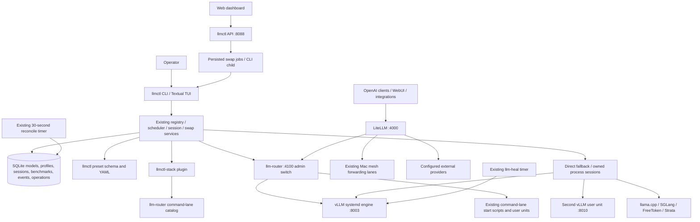

# llmctl and workstation inference audit

Audit date: November 3, 2026 (America/Los_Angeles). Baseline source: `b72b874`.
Runtime observations below were collected starting around 18:10–18:20 Pacific. They are
snapshots, not permanent configuration guarantees. This report was written
before implementation changes; subsequent changes and validation are recorded
at the end.

## Scope and evidence

The current llmctl source is authoritative for its behavior. Inspected its CLI,
API, settings schema, SQLite schema, adapters, scheduler, sessions, swaps,
operation records/lock, presets, plugins, health, validation, telemetry and
benchmark services and their tests. Used `graphify-out/GRAPH_REPORT.md` as a
navigation aid (November 3; 6,848 nodes, 19,903 edges, 12% inferred), not as proof
of runtime behavior. The untracked graph output was preserved.

Read the verified device reference and Linux discovery report, then rechecked
the services, listening ports, GPU telemetry and local HTTP endpoints. Inspected
the existing llm-router, llmctl-stack plugin, mesh forwarder and healer sources
and selected non-secret configuration fields. Queried SQLite with `mode=ro` and
allowlisted columns. Did not inspect credential files, process environments,
prompt logs or private inference payloads. Environment-file paths are recorded
as ownership references; their contents were not audited.

No inference requests, model switches, installs, service restarts, registry
cleanup, downloads, remote logins or configuration migrations were performed.
`doctor` is not strictly read-only internally: its storage check calls `init_db`.
Preset loading can also migrate legacy symlinks. Accordingly, the initial audit
used direct read-only probes instead of invoking those commands against live
state. Tests use temporary state and disabled stack plugins.

## Architecture and ownership

The layers have different jobs. llmctl is the operator/control surface;
llm-router owns normal request-driven desktop lane switching; systemd owns
managed processes; LiteLLM owns the client-facing routing layer; mesh owns
private Mac transport; llm-heal owns guarded recovery. Preserve these boundaries.
The standalone llmctl gateway on :9000 is intentionally disabled here.

**Deployment distinction:** this diagram describes the current checkout. The
normal `~/AI/bin/llmctl` shim executes the installed package in `~/AI/.venv`.
Resolving the import from `/tmp` (outside the checkout) and inspecting package
installation metadata confirmed a non-editable install pinned to **`16dc60f`**.
The stack plugin's dependency pins the same commit. Selected installed source
files match that pin; `services/op_lock.py` and `services/operations.py` are
absent there. The source checkout is **`b72b874`**, 47 files different from the
pin before this audit's fixes. Both report version 0.3.0. Running Python inside
the checkout resolves local code first and is not a valid deployment check.

Thus persistent swap jobs, the shared operation lock, and the latest benchmark
provenance/recovery changes are implemented in the checkout but **not installed
in the production package**. Existing database tables alone do not prove which
features the running API uses. The live API exposes the older benchmark routes;
the checkout additionally implements benchmark export/manifest support.

| Artifact | Existing source of truth | Consolidation implication |
| --- | --- | --- |
| Control settings | `~/.config/llmctl/settings.yaml`, typed in `llmctl/config.py` | Extend this schema for llmctl behavior; do not add another configuration service. |
| Registry, profiles, sessions, results | `~/.local/share/llmctl/llmctl.sqlite3` | Preserve IDs, history, host attribution and legacy data. |
| vLLM presets | Preset schema/store; canonical `~/.config/llmctl/presets`, legacy `~/.config/llm-models` | Five legacy YAML presets observed, no canonical YAML files. Legacy wins on duplicate aliases; inspect effective values before migration. |
| Active vLLM launch | Configured `~/AI/services/vllm-engine.env`; existing launcher and system unit | Rendered launch state is not a second model registry. Preserve per-preset runtime selection. |
| Command lanes and request policy | `~/AI/llm-router/config/router.yaml` | llmctl-stack already imports command lanes; avoid duplicating them in llmctl settings. |
| Host integrations | `~/AI/packages/llmctl-stack` plugin | Already supplies lanes, Harbor companion, Hermes checks, status and router TUI screen. |
| Remote connectivity | `~/.config/llm-gateway/forwarder.json` and existing mesh code | Keep LAN-first/Tailscale fallback and stable loopback endpoints. |
| Recovery | Existing systemd policies, `~/AI/heal`, leases and broken-lane state | Extend coordination rather than add another watchdog. |

## Verified runtime snapshot

- Both RTX 5090s report 32,607 MiB total; observed usage was 27,541 and
  26,695 MiB, with 0% instantaneous utilization. Allocated memory does not mean
  active token generation. Driver: 595.99.02.
- `vllm-engine` is active and `/v1/models` on loopback :8003 returns
  `qwen3.8-27b`. `/version` reports **0.30.0**. The configured generic binary
  belongs to `vllm-serve` (installed 0.25.1); `vllm-muse` has 0.30.0 and
  `vllm-laguna` has 0.25.1+cu129. These are distinct existing environments,
  not evidence that one should be deleted or upgraded.
- llmctl :8088 returns HTTP 200, state `ok`, two GPUs. Its live OpenAPI schema
  includes model/profile CRUD, session planning/start/stop/restart, GPU readings,
  benchmarks/sweeps/reruns, swap status/jobs/run/stop and UI routes in source.
- llm-router :4100 returns healthy with `qwen27b` loaded and no switch in
  progress. Its counters included 2,162 HTTP-200 requests and seven 502s for
  that backend over approximately 48 hours of process uptime. These are
  observed counters, not a new end-to-end benchmark or an explanation of errors.
- LiteLLM's liveness endpoint at `172.18.0.1:4000` returns 200. llmctl,
  llm-router and vLLM bind loopback; LiteLLM :4000 and Ollama :11434 have
  wildcard listeners. Firewall/public reachability was not tested.
- Ollama answers `/api/ps` with **no loaded models**. LM Studio :1234 answers
  `/v1/models` with 19 IDs; that list does not prove residency or local ownership.
- Registry: 142 models, 127 with `active=1`, 15 with null active flags; three
  profiles, two sessions, one historical successful benchmark, 1,545 events and
  zero operation records at observation. Model host counts: 62 desktop,
  18 `Yanniks-MacBook-Pro.local`, 26 `macbookpro.lan`, 36 unspecified.
  Catalog active flags are not liveness or residency.
- One adopted vLLM session is RUNNING on GPUs `[0,1]`; one owned llama.cpp
  session is STOPPED. The adopted row still names `vllm-tp.service`, but that
  system-unit alias exists and resolves; do not rewrite it merely for spelling.
- `vllm-engine2` is installed/configured as a user unit on :8010 and inactive.
  This is an available two-slot capability, not a failed service.
- llmctl API, llm-router, LiteLLM and mesh forwarder are active. Reconcile and
  heal timers are active; their oneshot services are inactive with last result
  `success`, which is normal. vLLM uses restart-on-failure, 15-second delay,
  three starts per 30 minutes; its observed restart counter was zero.
- The healer configuration is `mode: act`, with default model `qwen3.8-27b`,
  a 120-second settle time, two consecutive observations before probe-based
  recovery, and at most two actions per target in six hours. Recovery is already
  enabled, not merely an unconnected script.
- Fresh mesh state selected Tailscale for M5 swap/Ollama/fleet, LAN for M1
  swap/Ollama. Both LM Studio forwarding lanes had no healthy upstream.
  This proves the existing fallback is being selected, not that the Macs are
  fully healthy or that the unavailable lanes need restarting. No remote
  service ownership or inactivity intention was independently checked.

## Capability inventory

“Implemented” means source exists; “observed” means passive runtime evidence;
neither alone proves successful failover under load.

| Capability | Assessment | Evidence and limits |
| --- | --- | --- |
| Unified CLI/TUI/web/API | Implemented; API observed healthy | Existing run/stop/status/logs/doctor plus advanced verbs; `cli.py`, `api/`, `tui/`. No replacement UI needed. |
| Discovery and model registry | Implemented, populated | SQLite, filesystem/HF discovery, runtime adapters, host attribution, safe removal/purge checks. Remote catalog rows must not become local launch candidates. |
| Profiles and presets | Implemented, partially split by purpose | SQL runtime profiles and YAML vLLM presets both have consumers. Router profile references coexist with these. Consolidate by references/export and drift checks, not indiscriminate merging. |
| Engine integrations | Implemented | vLLM/systemd, llama.cpp, Ollama, LM Studio, SGLang, FreeToken, Strata, Python processes; external OpenAI endpoints are adopt-only. Not all are installed or currently used. |
| Start/stop/restart | Implemented | Session ownership, system/user unit delegation, process groups, stop-survivor tracking, readiness polling and restart plan replay. |
| Swap safety and recovery | Implemented; deployment and boundary gaps | Preflight/fit, GPU overlap and rollback exist in the installed generation. Durable operations/idempotency, host operation lock and surviving-child reconciliation exist in the newer checkout, not the installed package. Router/systemd/healer are not all participants in that lock. |
| Warm/on-demand lifecycle | Implemented for existing policy; broader policy partial | Router default `qwen27b`, idle revert 3,600s, polling 30s; request-driven starts; hold 300s; default failure cooldown 300s; Ollama eviction before vLLM. This restores one warm default, rather than a general per-model warm/TTL policy. |
| GPU-aware placement | Implemented; visibility defect | Most-free/balanced/least-used, VRAM margin, TP checks, overlap-based stop plans, two vLLM slots. Some inventory/discovery consumers still only see the main engine. |
| Health and load monitoring | Implemented; observed | NVML, runtime readiness, loaded-vs-installed distinction, vLLM/llama.cpp engine metrics, CLI/TUI/status plugin and existing machine monitor. Capacity inference remains an estimate, not a reservation. |
| Logs and diagnosis | Implemented | Session logs, journal integration, doctor/validate, structured operations and existing healer incident bundles. Raw production logs were not examined. |
| Failure recovery | Implemented; passive verification only | systemd retries, swap rollback, router broken/cooldown/lease guards and llm-heal. No crash or rollback was deliberately induced. |
| Benchmarks | Implemented; latest improvements not deployed | The checkout adds concurrent workload/provenance fixes, warmups/repetitions, manifests, comparison checks and export/rerun improvements beyond the installed pin. Only one old DB benchmark observed; preserve external benchmark artifacts and dates. |
| Mac workers and remote routes | Implemented; transport partly observed | Plugin/router/mesh integration, LM Link host attribution and documented remote healer ownership. No new remote agents needed based on this audit. |
| Optional llmctl gateway | Implemented, intentionally disabled here | Alias/fallback/streaming/auth exist. `router.auto_start` is only reported, not acted upon. It must not be confused with llm-router's working on-demand starts. |

## Prioritized gaps and incremental work

0. **P1 — Deploy and verify existing improvements before inventing replacements.**
   The installed package lacks the checkout's new operation ownership and
   benchmark safety work. Review the plugin's pin and full install delta,
   back up state consistently, then update through the existing deployment
   process in an approved maintenance window. Verify the actual imported
   package outside the checkout and refresh the API process. No inference-engine
   restart is inherently required for inventory fixes. Do not claim the new
   lock protects production until deployment is verified.
1. **P1 — Close cross-owner coordination gaps before expanding automation.**
   llmctl's `services/op_lock.py` serializes its own mutations. llm-router's
   `Switcher` has a separate asyncio lock, and its profile path restarts systemd
   directly; healer actions also include direct systemd commands. A request
   arriving during an advanced/direct llmctl mutation can therefore bypass
   llmctl's ownership boundary. This is a source-level race, not an observed
   production incident. Design a shared ownership handoff across these existing
   paths; do not simply nest the same lock around an HTTP switch, which can
   deadlock when callers wait for one another. Verify with competing-process
   tests before a controlled deployment.
2. **P1 — Protect active requests before shortening idle timers.**
   llm-router `idle.py` measures time since request arrival, not completion,
   and has no in-flight guard. A generation exceeding the one-hour threshold,
   or traffic sent directly to a backend, can appear idle. Multi-slot activity
   also needs per-backend accounting. Extend the existing request/streaming
   path with completion/cancellation-aware accounting and recheck under switch
   ownership. Do not introduce a second idle daemon or reduce the timeout now.
3. **P1 — Make the configured second engine visible consistently.**
   `ManagedUnitsConfig.roles()` excludes `vllm_engine2`; vLLM adapter candidates
   are hardcoded to the main engine. Status, discovery and health can disagree
   with two-slot scheduling. The port validator also ignores `user_scope`.
   Fix these existing consumers and cover main-down/second-up, both-up and
   user-scope behavior without changing placement or restarting either engine.
   Shared roles also feed unit installation; its renderer must retain the
   second engine's user scope rather than accidentally generate a system unit.
4. **P2 — Make API previews use the same settings as execution.**
   `/sessions/start` receives factory settings; `/sessions/plan` constructs a
   service that reloads defaults. Embedded/custom settings can therefore preview
   a different endpoint or binary. Pass the existing settings dependency through
   planning and related session routes; test plan/start parity in temporary state.
5. **P2 — Reconcile documentation and configuration ownership.**
   README's opening assumes one engine always spans both cards, contradicting
   two-slot code and the workstation configuration. Explain both modes. Preserve
   legacy presets, aliases and environments; stage any eventual preset/profile
   migration with effective-value comparison and rollback copies first.
6. **P2 — Review the seven observed router 502s with bounded, sanitized logs.**
   Counters do not identify cause or duration; do not change retries or restart
   policies from counters alone. Preserve existing cooldown/start-limit protection.
7. **P2 — Optional gateway readiness and inert setting.**
   The disabled standalone gateway includes STARTING sessions among routable
   sessions, before readiness is established, and advertises `auto_start` without
   implementing it. Correct/test these before enabling that gateway anywhere;
   enabling it on this desktop would duplicate the established ingress path.
8. **P3 — Generalize policy only when the concrete workload needs it.**
   Multiple pinned warm models plus per-lane idle unload require budget/admission,
   in-flight protection and ownership semantics across two GPUs. Start from
   existing router policy, slots and leases after P1 work; the current one-warm-
   default policy is already useful and should remain the default.

## Preserve

Keep current endpoints and served names, LiteLLM ingress, mesh fallback, unit
aliases, per-model launchers/environments, registry/profile IDs, benchmark history,
Harbor/Hermes hooks, intentional inactive lanes and stopped-session semantics.
Do not flatten every engine into a new supervisor, install Kubernetes, add a
parallel gateway/registry/watchdog, upgrade CUDA/vLLM globally, or mass-adopt,
purge or move model files. Idle models and unavailable optional runtimes are
not automatically faults.

## Validation and rollout record

Initial complete-suite attempts stalled after ten passing tests in an async
LM Studio discovery test inside the restricted environment. A thread stack
showed the event loop waiting with an idle worker; this did not establish an
application defect. Bounded regression tests ran normally outside that
restriction. Their state, settings, transport and service boundaries were
isolated. An initial related run produced 101 passes and three discovery failures
because the inherited HF cache exposed real models; the follow-up redirects
model caches too. These incomplete runs are not a passing full-suite baseline.

The first incremental changes address items 3–5: shared inventory includes the
configured second engine; the vLLM adapter uses the common roles filtered by
runtime; port validation and unit generation retain user scope; session API
routes use the factory settings consistently; documentation describes current
placement and the installed/checkout distinction. Existing placement, model
definitions and live policy were preserved. Regression tests first reproduced
the omitted-engine, wrong-scope and preview/start discrepancies. No live state
or installed package was modified. See [Operational workflow](OPERATIONS.md).

Final validation:

- Eight new regression cases cover second-engine status, role collisions,
  health/loaded-model/version discovery with the main engine down, discovery
  with both engines up, user-scope port checks, user-scope unit generation,
  and API preview/dry-run start settings parity. They reproduced the defects
  before their respective fixes.
- Related suite: **111 passed in 4.33s** after cache isolation.
- Full existing suite plus regressions: **1,671 passed, 1 skipped**, 2,039 warnings,
  in 388.91s; **86% statement coverage** (13,716 of 16,035 statements). The skip
  is the existing optional `llm_models_config.schema` parity module, unavailable
  in the test environment. No assertions were relaxed or tests disabled.
- Full-suite invocation used temporary home/config/data/state/model-cache
  locations, disabled stack plugin discovery, and inert PATH shims for
  `systemctl`, `sudo`, `docker` and `ssh`. The two test-created example-config
  alias overlay files were removed after completion.
- `ruff check .`: **All checks passed**. `git diff --check`: clean.
- Passive recheck at **18:31 Pacific**: router healthy on `qwen27b`, :8003 still
  advertising `qwen3.8-27b`; API/router/vLLM process IDs unchanged from the
  earlier observation, all active, restart counters still zero.
- Changes are uncommitted and not installed. `graphify-out/` is untouched.

Production lifecycle tests remain gated on a maintenance window and explicit
approval: single-slot coexistence, TP=2 takeover, failed-start rollback, long
stream protection, recovery after crash and Mac sleep/wake/fallback. Passive
health checks cannot establish these properties. No such test is claimed here.
