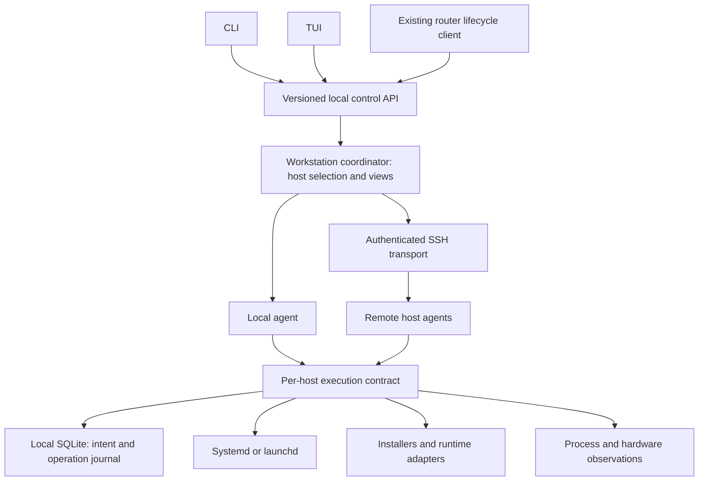

# Rust successor for llmctl

Status: proposed implementation plan, November 15, 2026. Progress: M2 done 2026-11-16 (pilot on `vllm-engine2`; [M2 plan](RUST-M2-PLAN.md)); M3 A–G done on mbp2 (G pilot on llama-swap 2026-11-17, [report](RUST-M3-PILOT-2026-11-17.md)); only the sleep/wake drill is open, blocked by Acronis' sleep lock ([M3 plan](RUST-M3-PLAN.md), [progress](RUST-M3-PROGRESS-2026-11-16.md)).

User priority: **daily use first, broader distribution later**. Rust is the
working language choice following the C++/Rust discussion. This document plans
the successor; it does not install it or transfer control of running workloads.

Confirmed scope: all listed engines are required for daily-use cutover except
SGLang and FreeToken, which are later. llmctl owns engine installation, versions,
upgrades, configuration and lifecycle, and actively manages remote hosts. The
user delegated switching, recovery, interface and compatibility defaults; the
choices below record those decisions. "Day one" means the first replacement
release, not the first development milestone.

## Outcome and scope

Build a multi-host control plane that can replace the Python implementation in the
owner's daily workflow: inspect workloads, explain launch configuration, preview
GPU conflicts, run/stop/restart, follow logs, and understand failures/recovery.
Keep model execution in the existing engines. Adopt verified existing installations
where possible, then bring their definitions and upgrade paths under management.
Target the Linux workstation and the owner's Macs with host-local agents.

Success means dependable operation and simpler ownership, with measured startup
and footprint improvements. Higher inference throughput is not a success claim.
The initial product is a CLI plus daemon; a usable TUI follows before daily-use
cutover. Active remote engine management is required before daily-use cutover.

Defer a new inference gateway, full Hugging Face discovery,
benchmark UI, web dashboard, automatic idle policy, and
public packaging until the core works. Existing tools can supply deferred
workflows where their lifecycle authority does not overlap the migrated scope.

Chosen defaults for the questions delegated by the user:

- **Switching:** explicit switches with an impact preview; preserve configured
  workloads and manual stops. Keep required existing router behavior through a
  coordinated integration, but defer new automatic placement/eviction policy.
- **Recovery:** bounded retries for positively identified engine failures, with
  backoff and a visible exhausted state. Never override manual stop/maintenance,
  interpret a disconnected host as a crashed engine, or blindly restart a busy
  engine after one probe failure. Exact probe/retry budgets are adapter settings.
- **Interfaces:** CLI, usable TUI, remote management and existing router integration
  are essential. Keep required existing API consumers working through a small
  compatibility surface. Web dashboard and benchmark UI can follow. Basic model
  acquisition/registration needed to run supported engines is in scope; rich
  Hugging Face search/planning can follow.
- **Compatibility:** preserve daily commands, required machine-readable contracts,
  configuration meaning and data. Allow documented redesign elsewhere, with an
  importer and migration report rather than full legacy API/plugin parity.

## Engine support and ownership

| Engine/interface | Replacement-release requirement |
| --- | --- |
| vLLM | Managed environment/version, launch definition, GPU placement and lifecycle on compatible hosts |
| llama.cpp | Managed binary/build version, launch definition and lifecycle on compatible Linux/macOS hosts |
| Ollama | Managed installation/service and engine-specific model lifecycle |
| LM Studio | Managed installation/version and supported service/model controls; verify unattended capabilities before claiming parity |
| MLX | Managed, explicitly identified serving package/runtime and lifecycle on compatible Macs |
| Strata | Managed installation/version and workload lifecycle on verified supported hosts |
| Custom servers | Declared install/build/run/health/stop recipes for the user's named servers; not universal inference of arbitrary projects |
| Generic OpenAI-compatible endpoints | Connection, identity and health support; lifecycle ownership additionally requires a known engine/launch recipe on an enrolled host |
| SGLang, FreeToken | Later; retain imported records without claiming lifecycle support |

M0 must identify the actual MLX serving implementation, custom server recipes,
supported engine/OS combinations, and install/upgrade mechanisms. Engine priority
does not imply every engine can run on every machine. A generic HTTP endpoint is
not an installation protocol: an external/provider endpoint remains externally
owned even when llmctl manages its connection. An unsupported vendor installation
or control operation is a declared release blocker or an explicit exception, not
something an adapter silently pretends to own.

Full ownership means one authoritative version/environment reference, launch
definition, service definition, lifecycle policy and upgrade history per managed
instance. Systemd on Linux and launchd on macOS remain process supervisors. Retain
externally configured and observe-only modes for migration and endpoints outside
our control; managed mode is the normal end state for the user's engines.

Version ownership does not mean automatic updates. Pin known-good versions, stage
upgrades separately where the engine permits it, validate configuration and model
compatibility, drain affected traffic, promote explicitly, and retain a usable
rollback target. For vendor installations that cannot coexist, define and test
the engine-specific backup/reinstall and downtime path before supporting upgrades.
Do not modify a serving Python environment in place. A binary rollback cannot undo
an incompatible model-store/config migration; those changes need their own
recoverable snapshot or must be rejected before upgrade execution.

Track ownership of shared model caches separately from engine installations.
Removing an engine must not delete shared weights or externally owned files.
Use user-scoped installation by default, explicit privileged steps where required,
and retain installer provenance, checksums where supplied, logs and failure state.

## Evidence and inherited requirements

The current implementation is a source of operational requirements, not a module
layout to translate. Relevant sources:

- [State machines](STATE-MACHINES.md), [operations](../llmctl/services/operations.py),
  and [operation locking](../llmctl/services/op_lock.py).
- [Process supervision](../llmctl/telemetry/process.py),
  [adapter contracts](../llmctl/adapters/base.py), and
  [plugins](../llmctl/plugins.py).
- [Existing consolidation plan](CONSOLIDATION-PLAN-2026-11-04.md) and
  [operating workflow](OPERATIONS.md).

The consolidation plan remains the guide for the existing deployment. This
successor proposes a future replacement for parts of its ownership design,
particularly reconciliation and lifecycle execution; it does not silently add
another production scheduler, watchdog, or authoritative inventory database.
Preserve its configuration provenance, manual-stop protection, scoped unit
control, and request-safety requirements. Historical warm/default policies must
be inventoried again before migration rather than treated as current settings.

Device knowledge and the Linux/Mac discovery reports were consulted as dated context.
No current installed revision, service health, address, or hardware attachment was
verified for this plan. The current checkout already contains operation journaling,
idempotency, PID identity checking, and failed-stop tracking; retain those lessons.

## Architecture

The router arrow is the target after an explicit integration change, not a claim
that the current router already calls the daemon. Inference traffic continues
through existing routing services and engines.

One host agent owns admitted lifecycle mutations and persisted observations for
its host. CLI/TUI clients never start engines or edit operational tables directly.
The workstation daemon initially combines coordinator and local-agent roles;
remote agents reuse the execution core. Each host has its own authoritative
operation journal, not a replicated global SQLite database. Coordinator views are
explicitly cached observations; accepted desired intent and its revision are
durable on the target host. Hardware resources are host-qualified; no cross-host
GPU memory pooling or distributed model scheduling is implied.

OS service managers supervise engines independently of agent connections. Separate
observation/reconciliation from recovery decisions. Bounded local recovery follows
accepted intent and policy, respects manual stop/maintenance, and does not restart
every unhealthy workload. Coordinate service-manager restart settings with this
policy so two independent retry loops cannot defeat the retry budget.

Use a user service and a Unix-domain control socket in a platform-appropriate
private runtime directory. Socket permissions limit access to that user. System-unit operations
use an explicit authorized path; do not run the whole daemon as root. The exact
system/user scope is part of a target's identity. Multi-user host ownership is
outside the initial supported scope. Implement Linux/systemd and macOS/launchd
behind distinct platform adapters; Linux PID identity and cgroup assumptions do
not carry over unchanged to macOS. Validate macOS process identity, service domains,
session/login behavior and restart persistence explicitly.

Initially use authenticated SSH transport to an enrolled agent's local API, through
a verified socket tunnel or fixed protocol bridge. SSH is the transport/bootstrap
mechanism, not a collection of shell commands implementing remote lifecycle logic.
Use existing SSH authentication and host verification without copying credentials.
Enrollment binds a stable host ID; an address change does not imply a new host.
No new publicly listening management port is required. Check client/agent protocol
compatibility before mutation and reject unsupported versions explicitly.

The target agent durably admits an operation before acknowledging it. The caller
chooses a stable host-scoped idempotency key before sending; reconnect/retry queries
the same operation rather than spawning another. Lost acknowledgements are
ambiguous, not failures to launch. After disconnect, show host observations as
stale/unknown; locally accepted operations and bounded policies continue. Do not
automatically fail workloads over to a second host on network loss. Cancellation
cannot be called successful until acknowledged by the target agent.

One active agent instance per host and revision-checked mutations reject concurrent
stale plans. This is not a highly available coordinator or consensus system.
Any action affecting multiple hosts is a sequence of separately journaled host
operations with partial outcomes and explicit recovery, not an atomic transaction.

Use versioned HTTP/JSON over the local socket, ordinary operation polling first,
and an event stream only when useful. Long operations return durable operation
IDs; client disconnect is not cancellation. Cancellation is an explicit request
with a recorded outcome and phase-dependent handling. A missing daemon yields a
clear error; there is no silent fallback to an independent executor. Local help,
config validation, and explicit offline planning can work without the daemon;
offline plans are estimates and must be revalidated before execution.

Start with a small Cargo workspace:

| Crate | Responsibility |
| --- | --- |
| `llmctl-core` | Typed identities, validated configuration, plans, transitions and domain errors; no system calls or database access |
| `llmctl-daemon` | Coordinator/agent roles, local API, host SQLite, operation executor, platform/engine adapters and reconciliation |
| `llmctl-client` | Wire DTOs/client, CLI binary, and later TUI modules |

Keep internal adapters as modules until an actual reuse boundary warrants another
crate. Do not create one crate per engine or an abstraction for every function.

Proposed library shortlist: Tokio for async I/O, Serde for wire/config values,
Clap for CLI, Axum for HTTP, Reqwest for upstream probes, rusqlite behind a bounded
database worker, tracing for diagnostics, and Ratatui/Crossterm for the later TUI.
These are candidates, not version pins. The first technical spike must verify
Unix-socket server/client support, shutdown behavior, SQLite execution boundaries,
YAML compatibility, and native dependency packaging against official docs before
locking the toolchain and dependencies. Prefer a maintained YAML reader rather
than choosing one from memory; keep the existing format for migration.

## Model the operational distinctions

Separate these concepts rather than expanding one session struct indefinitely:

- **Workload:** stable model/profile identity and effective launch configuration.
- **Host:** enrolled identity, platform, supported capabilities and last contact;
  resource and operation identifiers include their host.
- **Installation:** owned or imported engine version/build, environment/artifact
  location, provenance, upgrade candidate and rollback references.
- **Control authority:** systemd unit (scope + name), owned process, runtime API,
  or observe-only endpoint. Unsupported actions return explicit capability errors.
- **Desired intent:** explicitly running, explicitly stopped, or unmanaged;
  maintenance/manual-stop intent persists across daemon restarts.
- **Observation:** process/unit state, endpoint readiness, observed served model,
  GPU footprint, timestamp and evidence/unknown status.
- **Operation:** request, idempotency key, plan, resource reservation, phases,
  external-effect identity, final result and recovery result.

Rust enums and newtypes enforce internal distinctions; deserialized data and
database rows still need validation. Keep unknown external state representable.
Do not force every historical session transition into a compile-time typestate
API. Durable records must be reconstructable after a crash.

An endpoint answering does not by itself prove the expected model is ready.
Verify the adapter's served-model identity when available. Keep process alive,
endpoint ready, model loaded, and successful generation as distinct observations.
Readiness timeout can leave a still-loading workload in `starting`; a process
that exited is a different outcome. Read-only views show observation freshness.

Preserve failed termination separately from observed health: a process can be
serving again while the last stop remains visibly unsuccessful.

## Mutation and recovery contract

1. Resolve an unambiguous target and effective configuration with provenance.
2. Build a plan naming affected workloads, GPUs, units, expected model, and
   rollback actions. Any interactive confirmation refers to that concrete plan.
3. Admit under the operation coordinator; revalidate the plan against fresh
   observations. If its destructive footprint changed, return a revised plan
   rather than silently using an obsolete confirmation.
4. Persist intent and reserve affected resources before external side effects.
   Repeated identical idempotency keys return the same operation; conflicting
   reuse fails. Reject overlapping mutations clearly in the initial version.
5. Execute bounded phases, persisting progress and observable external identities.
   Do not hold a SQLite transaction open while waiting on systemd or HTTP.
6. Verify readiness or stop completion. Record attempted restoration separately
   from the original failure. A failed rollback becomes `needs_attention`.
7. Release ownership only when the execution/recovery state is understood. After
   a daemon crash, block conflicting admission until reconciliation has resolved
   the interrupted operation or made the unresolved condition explicit.

SQLite cannot transact atomically with process creation or systemd. Do not promise
exactly-once external effects. Persist deterministic unit/operation identities,
observe before retry, and handle the crash between an effect and its result write.
On restart, conservatively reconcile; do not blindly replay destructive steps.

Initially serialize GPU mutations across the managed host scope. Maintain the
existing shared lock protocol where cooperative legacy controllers remain. A
process-local mutex alone is insufficient. Request admission and destructive
switching must share a reservation/drain contract; observing zero active requests
once is insufficient. Unknown activity blocks automatic eviction. A two-GPU plan
must account for both cards and other consumers.

Never hold a lock while delegating to another component that must acquire the
same lock. During migration use one documented ownership handoff or refuse the
operation. Ultimately the router asks the daemon to switch instead of performing
its own stop/start sequence for migrated workloads.

## Process lifetime decision

Start the Linux pilot with existing named systemd units. Their known identity is recorded before
requests, and their lifetime is independent of a CLI connection or daemon task.
Distinguish unit activation from readiness; preserve system/user scope and query
the manager after ambiguous timeouts. Keep engine cgroups independent of the
daemon service so a daemon restart does not terminate an otherwise healthy engine.
Adoption is the entry step: compare effective launch configuration, import it,
preview the generated service definition, and explicitly transfer ownership once
equivalence is proven. Apply the same migration contract to launchd definitions
on Macs, using platform-specific supervision and identity checks.

Directly owned processes are a later compatibility milestone. Before enabling
them, choose and prove either systemd transient services with deterministic names
or a launch/recovery protocol that closes the spawn-before-PID-persistence gap.
Record platform-appropriate PID start and boot identity, handle descendants and escalation,
and never signal a recycled PID. A restarted daemon cannot recover a live Tokio
`Child` handle from SQLite; observation and termination must also work without it.

Tokio's subprocess lifetime is an explicit choice: dropping a child does not kill
it by default, and requesting termination is distinct from waiting/reaping.
`kill_on_drop` is not crash recovery and must not decide engine lifetime by
accident. See [Tokio process documentation](https://docs.rs/tokio/latest/tokio/process/index.html)
and [Command](https://docs.rs/tokio/latest/tokio/process/struct.Command.html).

## Compatibility and storage

Preserve the daily verbs (`ls`, `status`, `run`, `stop`, `logs`, `doctor`) and
explicit restart/adoption workflows. Freeze their required JSON fields, selector
rules, exit codes, and dry-run semantics as fixtures. Preserve intentional behavior;
record known defects and deliberate changes instead of blindly cloning outputs.

Keep settings/presets as configuration and SQLite as operational/catalog storage.
Effective configuration must explain precedence and source. Preserve absent vs.
explicit values, runtime interpreter/binary selection, extra arguments, model IDs,
host attribution, and history. No YAML-to-SQL flattening merely to simplify Rust.

Use an isolated development data directory per host and command name `llmctl-next` before
cutover. Import a consistent snapshot into a disposable successor database for
testing; never let Python and Rust independently migrate/write the same live DB.
This staging database is not a second production inventory authority.
Split imported operational records by verified owner host; retain their original
IDs with a host namespace and preserve history without turning catalog visibility
into remote execution permission. Host agents own local operational state, while
the coordinator aggregates it. Do not introduce two writable masters for one
host's workload or replicate credentials through the catalog.

Migration must produce a report of imported, unsupported, and conflicting records.
Unknown plugin/runtime data must be retained for round-trip/export or reported as
blocking; do not drop it silently. Historical operations remain historical and
imported sessions require fresh observation before they can authorize actions.

The existing Python plugin ABI will not carry over. Inventory which hooks daily
use actually depends on, especially router lanes and companion lifecycle hooks.
Implement required behavior through built-in adapters or a versioned subprocess
JSON protocol. Lifecycle helpers run only inside daemon-owned operations, with
bounded output, explicit results and no nested controller invocation. Defer
arbitrary UI plugins and dynamic native libraries. Never copy credential values
into fixtures, operation histories, or migration reports.

## Milestones and exit criteria

| Stage | Deliverable | Exit criterion |
| --- | --- | --- |
| M0: contracts and design spikes | Required engine/host capability matrix, install/upgrade recipes, MLX/custom-server identification, authority map, compatibility fixtures, dependency/platform/transport spikes | Every required engine has a supported-host target and concrete ownership path or a surfaced blocker; no silent deferral of day-one engines |
| M1: agent foundation | Workspace, host-qualified types, versioned local API, durable operations, fake engine/supervisor boundaries, CLI status/polling | Isolated tests prove idempotency, serialization, disconnect handling, restart reconstruction, unknown state and DB failures; no real GPU required |
| M2: one owned Linux workload — **done 2026-11-16** ([report](RUST-M2-PILOT-2026-11-16.md)) | Adopt, compare configuration, transfer ownership, plan/run/stop/restart/readiness/logs, pin version and exercise staged upgrade | Disposable-unit tests then controlled real-model pilot pass startup/stop failures, bounded recovery, daemon restart and upgrade rollback |
| M3: remote execution | macOS agent/supervisor adapter, SSH transport/enrollment, remote install and operations, local CLI targeting remote hosts | Linux-to-Mac management works; disconnect/lost ACK, sleep/reconnect, host/agent restart, stale plans and protocol mismatch do not duplicate effects or imply false success |
| M4: required engines and coordination | All day-one engine adapters/installers, model acquisition, GPU/memory placement, swaps/rollback, router handoff and companion hooks | Capability matrix passes installation, version pinning, launch, readiness, stop, logs and upgrade/recovery tests on applicable hosts; request safety/manual-stop protection pass |
| M5: daily-use replacement | Minimal multi-host TUI, config/preset parity, catalog operations, migration/reversal rehearsal | Daily workflows pass across workstation and Macs without legacy lifecycle writes; at least seven consecutive days of recorded pilot use |
| M6: cutover | Quiesced controllers per host, verified imports, client/router switch, exact builds and compatible agent versions | One authority per managed resource, preserved IDs/config/history, observed serving state matches, and reversal restores the previous control paths |
| M7: distribution and later engines | Portable installation/releases/docs, clean-host CI, dependency/license checks, SGLang/FreeToken expansion | Clean supported Linux/macOS control-plane install/remove without workstation paths or a Python requirement for the Rust agent; engine Python dependencies remain engine-specific |

All day-one engines remain replacement-release requirements; milestone order is
incremental implementation, not a reduction in that scope. The first pilot uses
an already-installed model, then proves installation/upgrade ownership with one
engine before generalizing to the remaining required adapters.
Shared-GPU ownership is the pilot boundary, not merely a single unit name: any
legacy actor able to evict or restart an overlapping workload must participate in
the handoff or be excluded for the pilot window.

The minimal TUI covers host/engine inventory, observations/freshness, operation progress,
run/stop confirmation, logs and recovery details. It consumes the same API and
performs no independent probing or mutation. Full screen-for-screen parity is
unnecessary unless the workflow matrix identifies a missing daily need.

No calendar estimate until M0/M1 establish Rust development pace and integration
scope. Exit criteria determine progression. Installers and remote ownership are
required for replacement; stage their implementation and pilots separately from
gateway replacement or unrelated UI expansion.

## Verification strategy

Reuse Python tests as a specification inventory. Run both implementations against
the same sanitized input/output scenarios where behavior is intentionally shared.
Do not mechanically port every test or use passing Python results as Rust evidence.

| Behavior | Existing starting point |
| --- | --- |
| PID identity and escalation | `tests/test_pid_identity.py` |
| Persistent operations, retries and interruption | `tests/test_operations.py` |
| Cross-process lock and delegation | `tests/test_op_lock.py` |
| Failed-stop marker vs. recovered health | `tests/test_sessions_terminate_failed.py` |
| Readiness and degraded state | `tests/test_readiness_and_health.py` |
| Swap and restoration | `tests/test_session_swap.py`, `tests/test_lane_swap.py` |
| System/user scope | `tests/test_unit_scope_queries.py` |
| Configuration rendering and preservation | `tests/test_vllm_env_parity.py`, `tests/test_preset_save_keeps.py` |

Add Rust model/property tests for transition invariants and resource conflicts;
subprocess tests for real socket concurrency, process identity and daemon crashes;
and temporary-SQLite tests for migrations, disk/write failures and idempotency.
Inject failure before/after each external-effect boundary. Include a crash after
unit activation but before result persistence, a recycled PID, an endpoint serving
the wrong model, a surviving process, failed restoration, a stale confirmed plan,
duplicate requests, and a busy router during a two-card switch.

Add multi-host fault tests for a lost admission response, transport loss mid-upgrade,
remote agent crash/restart, host reboot, Mac sleep/wake, address change, incompatible
agent version and two clients submitting stale plans. Verify accepted remote work
is discoverable after reconnect and cannot be replayed twice. Unreachable is not
stopped; disconnect must not trigger eviction, reinstall or cross-host failover.
Run actual platform integration tests on Linux and macOS before claiming either
platform supported; Linux mocks cannot establish launchd/process behavior.

Test each required install recipe in disposable environments: interrupted install,
wrong artifact/host architecture, insufficient space, failed validation, failed
promotion, incompatible model/config schema, rollback and uninstall with shared
model storage. Test recovery exhaustion and interaction with OS restart policies.

Keep automated tests isolated from the real user config, DB, engines and services.
Use temporary directories, fake executables/endpoints and disposable units in an
explicit integration suite. Run fmt, clippy and relevant tests on each substantive
change; run the full suite and migration replay at release gates.

Measure release-build help/version latency, daemon round-trip latency with fake
I/O, idle RSS/CPU, TUI responsiveness during long operations, and recovery time.
Use a defined workload, repeated samples and p50/p95; compare to the Python
baseline under the same conditions. Provisional UX budgets: help/version p95
under 100 ms, local cached-status p95 under 150 ms, and no UI stall longer than
100 ms caused by lifecycle work. These are proposed goals, not observed results.
Set RSS/recovery budgets after M0 measurements and separate upstream model-load
time from control-plane overhead.

## Cutover and reversal

Before the real pilot and again at cutover, recheck installed revisions, relevant
units/services, hooks/timers, runtime paths and actual ownership on each host. Export a consistent
snapshot after old writers are quiesced. Disable or redirect all conflicting
mutation paths for the affected resources, including router/healer and systemd
adoption hooks, launchd jobs and Mac-local switching/healing services. Reconcile live
units/services/endpoints into the imported state before
enabling new mutations. Preserve existing serving ports, model files and engine
environments unless a separate migration requires a change.

Reversal means more than restoring an old SQLite file: drain successor operations,
record what is actually running, stop its mutation authority, restore the old
compatible config/database or reverse-export supported changes, then reconcile
reality before re-enabling old clients/controllers. Preserve the successor audit
trail. During the pilot, avoid irreversible schema/config changes and unexportable
catalog edits. Rehearse both directions with temporary state before live use.

## First implementation batch

1. Record required engine/host capabilities, concrete installation recipes, MLX
   server identity and custom-server definitions. Map daily workflows, plugin
   hooks, controllers and compatibility promises to tests. Baseline isolated inputs.
2. Run small socket/SQLite/systemd-lifetime spikes and investigate the corresponding
   launchd and remote-agent transport contracts before freezing cross-platform types.
3. Add the Cargo workspace under `rust/` alongside Python, with independent build
   configuration and temporary test storage. Keep source close to reference tests
   during migration; decide on a separate repository only if it offers real value.
4. Implement host/installation/workload identities, capability/observation types and the pure planner against
   fake inventory. Add invalid-input and resource-conflict cases first.
5. Implement durable operation admission, idempotency and daemon restart tests.
6. Connect `llmctl-next status`, `run --dry-run`, and operation polling to the local
   daemon. Prove one fake workload end to end before adding a real runtime.

This batch is complete when a second client sees the same operation, an interrupted
client leaves it observable, daemon restart reconciles it honestly, and every test
can run without touching the installed inference stack.
